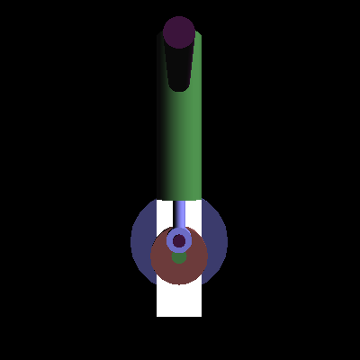

# Steam Engine: OpenGL Simulation

[](https://github.com/smadhu6364-beep/steam_engin/actions/workflows/build.yml)

A 3D animated steam engine (piston, crank and flywheel) written in C-style C++ with OpenGL and GLUT. Made as a computer graphics mini-project, based on the classic OpenGL steam engine example.



*Frame captured by the CI job, rendered with Mesa under a virtual display.*

## Features
- Animated piston, crankshaft and flywheel
- Rotate the view and change animation speed
- Toggle shading, textures, transparency and two light sources from a right-click menu

## Controls

| Key | Action |
| --- | --- |
| Arrow keys or `4` `6` `8` `2` | Rotate the view |
| `Space` | Start or stop the animation |
| `+` / `-` | Speed up / slow down |
| Right mouse button | Menu: shading, animation, texture, transparency, lights, speed |

## Build and run

You need a C++ compiler, CMake 3.16 or newer, OpenGL and freeglut.

### Linux (Debian/Ubuntu)
```bash
sudo apt install build-essential cmake freeglut3-dev libglu1-mesa-dev
cmake -S . -B build
cmake --build build
./build/steam_engine
```

### macOS
Apple's built-in GLUT works (it is deprecated but still ships with Xcode tools):
```bash
xcode-select --install   # if you don't have the command line tools
cmake -S . -B build
cmake --build build
./build/steam_engine
```

### Windows
With [vcpkg](https://vcpkg.io) and Visual Studio:
```powershell
vcpkg install freeglut
cmake -S . -B build -DCMAKE_TOOLCHAIN_FILE=<vcpkg-root>/scripts/buildsystems/vcpkg.cmake
cmake --build build --config Release
.\build\Release\steam_engine.exe
```
Or with MSYS2/MinGW: `pacman -S mingw-w64-ucrt-x86_64-freeglut`, then the same CMake commands. The original Code::Blocks project (`steam_engin.cbp`) is still included.

## CI
Every push builds the project on Ubuntu with freeglut, runs it for a few seconds under Xvfb and saves a screenshot as a build artifact.
